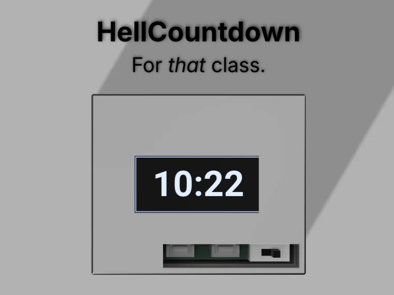
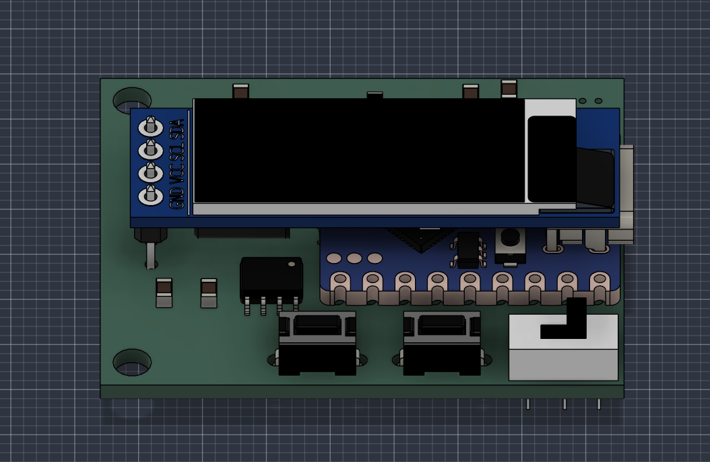

# HellCountdown 

### 🚩Submitted as a part of [Hack Club Fabricate](https://fabricate.hackclub.com/projects/218)

School days run on a timetable of oddly spaced bells (08:15, 09:00, 09:55, 10:50 ...). Working out "how long is left?" means squinting at a wall clock and doing subtraction in your head, over and over, all day, while trying to watch the teacher's lecture. HellCountdown is a small, battery-powered device that does just one thing: it shows the time left until the next bell on a small OLED screen, for a distraction-free jewel on your desk.

## Features
* The bell times are baked into the firmware, so it just always counts down to whichever bell is next
* A battery-backed real-time clock (RTC) keeps the clock running, even with the power switch off. Wi-Fi is only used once, to set the clock.
* Simple, two-button interface
  * Left: wake the screen. Press again while it's awake to lock it on; press again to unlock.
  * Right: open the custom timer picker. Left subtracts a minute, right adds a minute. Hold to speed up, press both to start the countdown, press right to cancel it.
* Rechargeable: uses a 400 mAh Li-Po, charged over the ESP's USB-C port. 

## Hardware

| Part | Function |
|---|---|
| Waveshare ESP32-S3 Mini | Orchestrates the entire device |
| 0.91" 128x32 SSD1306 OLED (I2C, 0x3C) | Display |
| PCF8563T RTC (I2C, 0x51) + 32.768 kHz crystal | RTC |
| MCP73831 charger | Charger |
| XC6220B331 3.3 V LDO | Supply for the RTC |
| SD0805S040S1R0 Schottky | Stops power backfeeding |
| Li-Po 3.7 V 400 mAh | Battery |
| Slide switch (SPDT) + two tact switches | Power and user buttons |

## Pin map

| GPIO | Function |
|---|---|
| 1 | OLED SCL |
| 2 | OLED SDA |
| 4 | PCF8563 INT (10 kOhm pull-up) |
| 5 | PCF8563 SCL |
| 6 | PCF8563 SDA |
| 12 | Left button (SW3), internal pull-up |
| 13 | Right button (SW2), internal pull-up |

## Configure and install

At the top of the sketch:

- `WIFI_SSID`, `WIFI_PASS`: your Wi-Fi credentials (used only to set the clock).
- `BELLS[]`: the bell times, as "HH:MM" strings.
- `SCREEN_TIMEOUT_MS`: how long the screen stays on.
- `PICK_MIN`, `PICK_MAX`: the custom timer's range in minutes (default 1-99).

Then:

- Install the ESP32 board support in the Arduino IDE (board: ESP32S3 Dev Module, "USB CDC On Boot" enabled).
- Install **RTClib**, **Adafruit SSD1306** and **Adafruit GFX** from the Library Manager.
- Upload over USB-C.

## Bill of materials

| Item  | €/qty  | Qty| €| Notes - Link|
|-------------------------------------------|--------|-------|--------|---------------|
| GRobotronics|  | |  | |
| Waveshare ESP32-S3 Zero – 4MB | 8.20€  | 1  | 8.20€  | https://grobotronics.com/waveshare-esp32-s3-mini-wi-fi-and-bluetooth-5.html|
| Display 0.91" 128x32 OLED Module | 7.40€  | 1  | 7.40€  | https://grobotronics.com/display-0.91-128x32-oled-module.html  |
| Li-Po Battery 3.7V 400mAh Molex 1.25mm | 4.40€  | 1  | 4.40€  | https://grobotronics.com/li-po-battery-3-7v-400mah-molex-1-25mm.html#group_200376ac79e76281b7-2 |
| Led 0805 SMD Red Clear  | 0.10€  | 10 | 1.00€  | https://grobotronics.com/led-0805-smd-red-clear.html  |
| 1kΩ Resistor SMD 0805 1/8W | 0.02€  | 10 | 0.20€  | https://grobotronics.com/resistor-smd-0805-el.html?variation_id=11539|
| 4.7kΩ Resistor SMD 0805 1/8W  | 0.02€  | 10 | 0.20€  | https://grobotronics.com/resistor-smd-0805-el.html?variation_id=11439#group_114396ad377cb0bd9a  |
| 10kΩ Resistor SMD 0805 1/8W| 0.02€  | 10 | 0.20€  | https://grobotronics.com/resistor-smd-0805-el.html?variation_id=11538|
| 32.768 Khz Crystal| 0.25€  | 1  | 0.25€  | https://grobotronics.com/crystal-32-768-khz.html|
| Slide Switch Mini SPDT - 0.3A/30VDC | 0.20€  | 1  | 0.20€  | https://grobotronics.com/mini-spdt-0.3a-30vdc.html |
| Tact switch 6x3mm 4.3mm 2pin PCB | 0.10€  | 2  | 0.20€  | https://grobotronics.com/tact-switch-6x3mm-4.3mm-2pin-pcb.html |
| Pin Header 1x40 Male 2.54 mm Black  | 0.10€  | 1  | 0.10€  | https://grobotronics.com/pin-header-1x40-male-2.54-mm-black.html  |
| Pin Header 1x4 Female 2.54mm  | 0.05€  | 1  | 0.05€  | https://grobotronics.com/pin-header-1x4-female-2.54mm.html  |
| Soldering Wire Brofil 60 16g 1mm | 2.40€  | 1  | 2.40€  | https://grobotronics.com/soldering-wire-brofil-60-16g-1mm.html |
| Creality Ender PLA 1kg – Black [PRORATED] | 12.40€ | 0.010 | 0.12€  | PRORATED - https://grobotronics.com/creality-ender-pla-1-75mm-1kg-black.html  |
| Shipping | 0.00€  | 0  | 2.50€  | BOXNOW|
| TOTAL (EUR) |  | 50 | 27.42€ | |
| |  | |  | |
| Intershop|  | |  | |
| MCP73831T-2ACI/OT / Charger| 1.81€  | 1  | 1.81€  | https://www.inter-shop.gr/shop/hlektronika/%ce%b7%ce%bc%ce%b9%ce%b1%ce%b3%cf%89%ce%b3%ce%bf%ce%af/%ce%bf%ce%bb%ce%bf%ce%ba%ce%bb%ce%b7%cf%81%cf%89%ce%bc%ce%ad%ce%bd%ce%b1-%ce%ba%cf%85%ce%ba%ce%bb%cf%8e%ce%bc%ce%b1%cf%84%ce%b1/%cf%81%cf%85%ce%b8%ce%bc%ce%b9%cf%83%cf%84%ce%ad%cf%82-%cf%84%ce%ac%cf%83%ce%b7%cf%82-%ce%bf%ce%bb%ce%bf%ce%ba%ce%bb%ce%b7%cf%81%cf%89%ce%bc%ce%ad%ce%bd%ce%b1-%ce%ba%cf%85%ce%ba%ce%bb%cf%8e%ce%bc/elegktes-batarion-kai-energeias-kyk-rythmistes-tasis-olokliromena-kyklom/mcp73831t-2aci-otic-pmic-%ce%b5%ce%bb%ce%b5%ce%b3%ce%ba%cf%84%ce%ae%cf%82-%cf%86%cf%8c%cf%81%cf%84%ce%b9%cf%83%ce%b7%cf%82-%cf%83%cf%85%cf%83%cf%83%cf%89%cf%81%ce%b5%cf%85%cf%84%cf%8e%ce%bd-i/|
| XC6220B331MR-G / LDO Reg/tor  | 2.33€  | 1  | 2.33€  | https://www.inter-shop.gr/shop/hlektronika/%ce%b7%ce%bc%ce%b9%ce%b1%ce%b3%cf%89%ce%b3%ce%bf%ce%af/%ce%bf%ce%bb%ce%bf%ce%ba%ce%bb%ce%b7%cf%81%cf%89%ce%bc%ce%ad%ce%bd%ce%b1-%ce%ba%cf%85%ce%ba%ce%bb%cf%8e%ce%bc%ce%b1%cf%84%ce%b1/%cf%81%cf%85%ce%b8%ce%bc%ce%b9%cf%83%cf%84%ce%ad%cf%82-%cf%84%ce%ac%cf%83%ce%b7%cf%82-%ce%bf%ce%bb%ce%bf%ce%ba%ce%bb%ce%b7%cf%81%cf%89%ce%bc%ce%ad%ce%bd%ce%b1-%ce%ba%cf%85%ce%ba%ce%bb%cf%8e%ce%bc/%cf%83%cf%84%ce%b1%ce%b8%ce%b5%cf%81%ce%bf%cf%80%ce%bf%ce%b9%ce%b7%cf%84%ce%ad%cf%82-%ce%b3%cf%81%ce%b1%ce%bc%ce%bc%ce%ae%cf%82-%ce%bf%ce%bb%ce%bf%ce%ba%ce%bb%ce%b7%cf%81-%ce%ba%cf%85%ce%ba%ce%bb/%cf%83%cf%84%ce%b1%ce%b8%ce%b5%cf%81%ce%bf%cf%80%ce%bf%ce%b9%ce%b7%cf%84%ce%ad%cf%82-%cf%84%ce%ac%cf%83%ce%b7%cf%82-%cf%87%cf%89%cf%81%ce%af%cf%82-%cf%81%cf%8d%ce%b8%ce%bc%ce%b9%cf%83%ce%b7-ldo-%cf%83/xc6220b331mr-gic-%cf%83%cf%84%ce%b1%ce%b8%ce%b5%cf%81%ce%bf%cf%80%ce%bf%ce%b9%ce%b7%cf%84%ce%ae%cf%82-%cf%84%ce%ac%cf%83%ce%b7%cf%82-ldo%ce%b3%cf%81%ce%b1%ce%bc%ce%bc%ce%b9%ce%ba%cf%8c%cf%87/ |
| PCF8563T / RTC | 2.76€  | 1  | 2.76€  | https://www.inter-shop.gr/shop/hlektronika/%ce%b7%ce%bc%ce%b9%ce%b1%ce%b3%cf%89%ce%b3%ce%bf%ce%af/%ce%bf%ce%bb%ce%bf%ce%ba%ce%bb%ce%b7%cf%81%cf%89%ce%bc%ce%ad%ce%bd%ce%b1-%ce%ba%cf%85%ce%ba%ce%bb%cf%8e%ce%bc%ce%b1%cf%84%ce%b1/%ce%bf%ce%bb%ce%bf%ce%ba%ce%bb%ce%b7%cf%81%cf%89%ce%bc%ce%ad%ce%bd%ce%b1-%ce%ba%cf%85%ce%ba%ce%bb%cf%8e%ce%bc%ce%b1%cf%84%ce%b1-%cf%80%ce%b5%cf%81%ce%b9%cf%86%ce%b5%cf%81%ce%b5%ce%b9%ce%b1%ce%ba%ce%ac/%ce%ba%cf%85%ce%ba%ce%bb%cf%8e%ce%bc%ce%b1%cf%84%ce%b1-rtc-%ce%bf%ce%bb%ce%bf%ce%ba%ce%bb%ce%b7%cf%81%cf%89%ce%bc%ce%ad%ce%bd%ce%b1-%ce%ba%cf%85%ce%ba%ce%bb%cf%8e%ce%bc%ce%b1%cf%84%ce%b1-%cf%80%ce%b5/pcf8563t-5-518ic-%ce%ba%cf%8d%ce%ba%ce%bb%cf%89%ce%bc%ce%b1-rtc-i2cserial-so8-18%c3%b755v-pcf8563t-5518/ |
| SD0805S040S1R0 / Schottky Diode  | 0.77€  | 1  | 0.77€  | https://www.inter-shop.gr/shop/hlektronika/%ce%b7%ce%bc%ce%b9%ce%b1%ce%b3%cf%89%ce%b3%ce%bf%ce%af/%ce%b4%ce%af%ce%bf%ce%b4%ce%bf%ce%b9/%ce%b4%ce%af%ce%bf%ce%b4%ce%bf%ce%b9-schottky/%ce%b4%ce%af%ce%bf%ce%b4%ce%bf%ce%b9-schottky-smd-%ce%b4%ce%af%ce%bf%ce%b4%ce%bf%ce%b9-schottky-%ce%b4%ce%af%ce%bf%ce%b4%ce%bf%ce%b9-%ce%b7%ce%bc%ce%b9%ce%b1%ce%b3%cf%89%ce%b3%ce%bf%ce%af/sd0805s040s1r0%ce%b4%ce%af%ce%bf%ce%b4%ce%bf%cf%82-%ce%b1%ce%bd%cf%8c%cf%81%ce%b8%cf%89%cf%83%ce%b7%cf%82-schottky-0805-smd-40v-1a-%cf%81%ce%bf%ce%bb%cf%8c%cf%84%ce%b1%ce%b9%ce%bd%ce%af%ce%b1/|
| WR08X5101FTL (5.1kΩ) | 0.19€  | 1  | 0.19€  | https://www.inter-shop.gr/shop/hlektronika/%cf%80%ce%b1%ce%b8%ce%b7%cf%84%ce%b9%ce%ba%ce%ac-%ce%b5%ce%be%ce%b1%cf%81%cf%84%ce%ae%ce%bc%ce%b1%cf%84%ce%b1/%ce%b1%ce%bd%cf%84%ce%b9%cf%83%cf%84%ce%ac%cf%83%ce%b5%ce%b9%cf%82/%ce%b1%ce%bd%cf%84%ce%b9%cf%83%cf%84%ce%ac%cf%83%ce%b5%ce%b9%cf%82-smd-%ce%b1%ce%bd%cf%84%ce%b9%cf%83%cf%84%ce%ac%cf%83%ce%b5%ce%b9%cf%82-%cf%80%ce%b1%ce%b8%ce%b7%cf%84%ce%b9%ce%ba%ce%ac-%ce%b5%ce%be/wr08x5101ftl-%ce%b1%ce%bd%cf%84%ce%af%cf%83%cf%84%ce%b1%cf%83%ce%b7-thick-film-0805-51k%cf%89-125mw-%c2%b11-150v-100ppm-c-wr08x5101ftl/|
| 0805B104K101CT (100nF)  | 0.44€  | 1  | 0.44€  | https://www.inter-shop.gr/shop/hlektronika/%cf%80%ce%b1%ce%b8%ce%b7%cf%84%ce%b9%ce%ba%ce%ac-%ce%b5%ce%be%ce%b1%cf%81%cf%84%ce%ae%ce%bc%ce%b1%cf%84%ce%b1/%cf%80%cf%85%ce%ba%ce%bd%cf%89%cf%84%ce%ad%cf%82/%cf%80%cf%85%ce%ba%ce%bd%cf%89%cf%84%ce%ad%cf%82-mlcc/%cf%80%cf%85%ce%ba%ce%bd%cf%89%cf%84%ce%ad%cf%82-mlcc-smd-%cf%80%cf%85%ce%ba%ce%bd%cf%89%cf%84%ce%ad%cf%82-mlcc/0805b104k101ct-%cf%80%cf%85%ce%ba%ce%bd%cf%89%cf%84%ce%ae%cf%82-%ce%ba%ce%b5%cf%81%ce%b1%ce%bc%ce%b9%ce%ba%cf%8c-100nf-100v-x7r-%c2%b110-0805-0805b104k101ct/|
| 08055D105KAT2A (1uF) | 0.85€  | 2  | 1.69€  | https://www.inter-shop.gr/shop/hlektronika/%cf%80%ce%b1%ce%b8%ce%b7%cf%84%ce%b9%ce%ba%ce%ac-%ce%b5%ce%be%ce%b1%cf%81%cf%84%ce%ae%ce%bc%ce%b1%cf%84%ce%b1/%cf%80%cf%85%ce%ba%ce%bd%cf%89%cf%84%ce%ad%cf%82/%cf%80%cf%85%ce%ba%ce%bd%cf%89%cf%84%ce%ad%cf%82-mlcc/%cf%80%cf%85%ce%ba%ce%bd%cf%89%cf%84%ce%ad%cf%82-mlcc-smd-%cf%80%cf%85%ce%ba%ce%bd%cf%89%cf%84%ce%ad%cf%82-mlcc/08055d105kat2a-%cf%80%cf%85%ce%ba%ce%bd%cf%89%cf%84%ce%ae%cf%82-%ce%ba%ce%b5%cf%81%ce%b1%ce%bc%ce%b9%ce%ba%cf%8c-mlcc-1uf-50v-x5r-%c2%b110-smd-0805-180mm-08055d105kat2a/|
| EMK212B7475KG (4.7uF)| 0.85€  | 2  | 1.70€  | https://www.inter-shop.gr/shop/hlektronika/%cf%80%ce%b1%ce%b8%ce%b7%cf%84%ce%b9%ce%ba%ce%ac-%ce%b5%ce%be%ce%b1%cf%81%cf%84%ce%ae%ce%bc%ce%b1%cf%84%ce%b1/%cf%80%cf%85%ce%ba%ce%bd%cf%89%cf%84%ce%ad%cf%82/%cf%80%cf%85%ce%ba%ce%bd%cf%89%cf%84%ce%ad%cf%82-mlcc/%cf%80%cf%85%ce%ba%ce%bd%cf%89%cf%84%ce%ad%cf%82-mlcc-smd-%cf%80%cf%85%ce%ba%ce%bd%cf%89%cf%84%ce%ad%cf%82-mlcc/emk212b7475kg-t-%cf%80%cf%85%ce%ba%ce%bd%cf%89%cf%84%ce%ae%cf%82-%ce%ba%ce%b5%cf%81%ce%b1%ce%bc%ce%b9%ce%ba%cf%8c-mlcc-47uf-16v-x7r-%c2%b110-smd-0805-2x125mm-emk212b7475kg-t/ |
| CC0805KKX5R5BB226 (22uF)| 0.97€  | 1  | 0.97€  | https://www.inter-shop.gr/shop/hlektronika/%cf%80%ce%b1%ce%b8%ce%b7%cf%84%ce%b9%ce%ba%ce%ac-%ce%b5%ce%be%ce%b1%cf%81%cf%84%ce%ae%ce%bc%ce%b1%cf%84%ce%b1/%cf%80%cf%85%ce%ba%ce%bd%cf%89%cf%84%ce%ad%cf%82/%cf%80%cf%85%ce%ba%ce%bd%cf%89%cf%84%ce%ad%cf%82-mlcc/%cf%80%cf%85%ce%ba%ce%bd%cf%89%cf%84%ce%ad%cf%82-mlcc-smd-%cf%80%cf%85%ce%ba%ce%bd%cf%89%cf%84%ce%ad%cf%82-mlcc/cc0805kkx5r5bb226-%cf%80%cf%85%ce%ba%ce%bd%cf%89%cf%84%ce%ae%cf%82-%ce%ba%ce%b5%cf%81%ce%b1%ce%bc%ce%b9%ce%ba%cf%8c-mlcc-22uf-63v-x5r-%c2%b110-smd-0805-cc0805kkx5r5bb226/  |
| Shipping | 2.99€  | 1  | 2.99€  | ACS Lockers |
| VAT|  | | 3.76€  | |
| TOTAL (EUR) |  | 12 | 19.41€ | |
| |  | |  | |
| JLCPCB|  | |  | |
| PCB, 34*41mm, 5pcs| 3.62€  | 1  | 3.62€  | |
| Shipping | 5.49€  | 1  | 5.49€  | |
| VAT, Duties | 7.23€  | 1  | 7.23€  | |
| TOTAL (EUR) |  | | 16.34€ | |
| |  | |  | |
| GRAND TOTAL (EUR) |  | | 63.17€ | (about 69.49 USD, considering 1€=$1.10 (as of 15 Nov) |

## Features that are Work In Progress

- **Not yet tested as an assembled device.** The firmware logic isn't verified with the other components yet.
- **No deep sleep yet.** "Sleep" currently turns only the OLED off; the ESP keeps running. 

## AI Disclosure

This project was built with help from an AI assistant, that drove the development of the firmware, and reviewed the PCB wiring.

## License

[MIT](LICENSE)